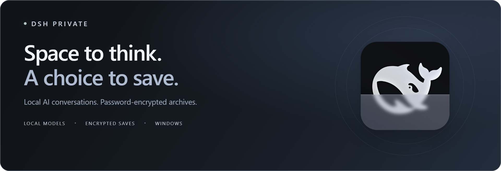

  

<h1 align="center">DSH Private</h1>

  <strong>Temporary conversations. Encrypted archives. Your local models.</strong> 
  A Windows desktop app that opens directly into privacy mode.

  
  
  
  

<h3 align="center"><a href="https://github.com/SparklingAstronaut/dsh-private/releases/download/v0.1.0-preview.4/DSH-Private-0.1.0-preview.4-windows-x64.zip">Download for Windows ↗</a></h3>

  <a href="https://github.com/SparklingAstronaut/dsh-private/releases/tag/v0.1.0-preview.4">Release notes</a> ·
  <a href="https://github.com/SparklingAstronaut/dsh-private/releases/download/v0.1.0-preview.4/SHA256SUMS.txt">SHA-256 checksums</a> ·
  <a href="docs/configuration.md">Configuration</a> ·
  <a href="README.zh-CN.md">简体中文</a>

Independent community preview. Not an official DeepSeek or DSH Desktop release.

## A space for conversations you choose to keep

Open the app, unlock, and talk to your own local model. Conversations are temporary by default; you decide when to save an encrypted snapshot. Close the app to end your private session.

<table>
  <tr>
    <td width="50%" valign="top">
      <h3>01 · Private from the start</h3>
      
Go straight to the password gate. Unlock to begin a temporary conversation, with a confirmation before discarding unsaved changes on exit.

    </td>
    <td width="50%" valign="top">
      <h3>02 · Save by choice</h3>
      
Explicitly save chats and attachments to password-encrypted archives. Reopen them later, change your password, or delete what you no longer need.

    </td>
  </tr>
  <tr>
    <td width="50%" valign="top">
      <h3>03 · Bring your local model</h3>
      
Connect to an OpenAI-compatible model server on your own computer. Select your model in Connection; a second model is optional.

    </td>
    <td width="50%" valign="top">
      <h3>04 · A separate app profile</h3>
      
Settings and archives live in DSH Private's own data directory. It does not automatically import another DSH installation's configuration or conversations.

    </td>
  </tr>
</table>

## Get started

**You need:** Windows 10/11 x64 and your own local OpenAI-compatible model server. The ZIP includes the app runtime; model weights and a model server are not included. This preview is unsigned.

1. **Download and extract.** Unpack the **entire** ZIP into a writable local folder, then run `DSH Private.exe`.
2. **Connect a local model.** Start your model server. On the password screen, expand **Connection**, enter its loopback API URL (for example `http://127.0.0.1:1234/v1`), detect or enter its model ID, then save and restart. Model B is optional.
3. **Create your vault password.** Generate a password, keep it somewhere safe, then unlock. **There is no password recovery.**
4. **Chat, then choose what to keep.** Use the private chat menu to save an encrypted snapshot. When closing the app, confirm whether to discard any unsaved changes.

Core chat and setup support English. Some advanced privacy and Studio dialogs currently use Chinese labels.

**New in Preview 4:** neutral model slot names (`model-a` / `model-b`) with automatic conversion of Preview 1–3 archives, DSH Private named in the executable's version information, the DSH Private logo in the tray at every display scale, and source formatted for review with a CI formatting check. Encrypted caches, startup recovery, and public build verification from Preview 3 are retained. [View release →](https://github.com/SparklingAstronaut/dsh-private/releases/tag/v0.1.0-preview.4)

<strong>Optional: images, Studio, tools, and MCP</strong>

The app retains image/Studio, tool execution, and MCP integration code. These features require your own runtimes and configuration; the portable preview does not bundle image models, Python environments, third-party accounts, or external tools.

See [configuration](docs/configuration.md) for model slots, vision support, and optional integrations.

## Your data and privacy

Saved archives use **AES-256-GCM** encryption with scrypt-derived keys. Only explicit saves are intended to persist chat content; normal shutdown cleans the app's temporary working data.

| Data | Default location |
| --- | --- |
| App data | `%APPDATA%\DSH-Private` |
| Encrypted archives | `%APPDATA%\DSH-Private\private\Incognito` |
| Connection settings | `%APPDATA%\DSH-Private\settings.json` |

**Before upgrading:** close the app and back up its data directory. Keep the vault password separately. DSH Private does not automatically migrate another installation's archives. Archives from Preview 1–3 open normally; once Preview 4 or later saves them, they store the neutral slot names `model-a` / `model-b` and can no longer be opened by Preview 1–3.

The local model server runs separately: closing DSH Private does not stop it or erase its logs. Connection settings and operational logs are not encrypted, and optional tools may access files or networks. This is a developer-tested preview, not an independently audited security product or a guarantee of forensic erasure. Read the [privacy and security boundaries](SECURITY.md) before using sensitive data.

## Explore the project

| I want to… | Start here |
| --- | --- |
| Configure models or optional integrations | [Configuration](docs/configuration.md) |
| Understand what privacy mode protects | [Privacy and security](SECURITY.md) |
| Build the app or run the checks | [Development guide](docs/development.md) |
| Report a bug or suggest an improvement | [GitHub Issues](https://github.com/SparklingAstronaut/dsh-private/issues) |

For public bug reports, use synthetic examples and include your app version, Windows version, and steps to reproduce. Keep passwords, tokens, private conversations, and real archives out of reports.

## Built on open source

DSH Private builds on [DSH Desktop](https://github.com/anywhere-labs/dsh-desktop), [DeepSeek Harness](https://github.com/deepseek-ai/deepseek-harness), and [kvmem-agent-16gb](https://github.com/G0K0U/kvmem-agent-16gb). Thank you to their authors and contributors.

Released under the [MIT License](LICENSE). See [NOTICE](NOTICE.md) for upstream attribution and bundled third-party licenses. Project names are used to describe technical origins and compatibility; no affiliation or endorsement is implied.
