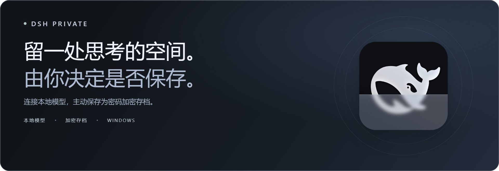

  

<h1 align="center">DSH Private</h1>

  <strong>临时对话，加密存档，连接你自己的本地模型。</strong> 
  打开即进入隐私模式的 Windows 桌面应用。

  
  
  
  

<h3 align="center"><a href="https://github.com/SparklingAstronaut/dsh-private/releases/download/v0.1.0-preview.9/DSH-Private-0.1.0-preview.9-windows-x64.zip">下载 Windows 版 ↗</a></h3>

  <a href="https://github.com/SparklingAstronaut/dsh-private/releases/tag/v0.1.0-preview.9">更新说明</a> ·
  <a href="https://github.com/SparklingAstronaut/dsh-private/releases/download/v0.1.0-preview.9/SHA256SUMS.txt">SHA-256 校验值</a> ·
  <a href="docs/configuration.md">配置说明</a> ·
  <a href="README.md">English</a>

独立社区预览版，不是 DeepSeek 或 DSH Desktop 官方发行版。

## 对话是否留下，由你决定

打开应用、解锁，然后与自己的本地模型对话。聊天默认临时保留；需要留下时，由你主动保存为加密快照。关闭应用，即结束本次隐私会话。

<table>
  <tr>
    <td width="50%" valign="top">
      <h3>01 · 从打开开始保护</h3>
      
启动直接进入密码页，解锁后开始临时对话。退出时，如果有尚未保存的更改，会先确认是否丢弃。

    </td>
    <td width="50%" valign="top">
      <h3>02 · 想留下，再保存</h3>
      
主动将对话和附件保存到密码加密的存档。以后可以重新打开，也可以更改密码或删除不再需要的内容。

    </td>
  </tr>
  <tr>
    <td width="50%" valign="top">
      <h3>03 · 连接自己的本地模型</h3>
      
连接电脑上的 OpenAI 兼容模型服务，在 Connection 中选择模型。可按需配置第二个模型。

    </td>
    <td width="50%" valign="top">
      <h3>04 · 使用独立的数据目录</h3>
      
设置和存档放在 DSH Private 自己的目录中，不会自动导入其他 DSH 安装的配置或聊天记录。

    </td>
  </tr>
</table>

## 开始使用

**准备好：** Windows 10/11 x64，以及你自己的本地 OpenAI 兼容模型服务。ZIP 包含应用运行组件，不包含模型权重或模型服务器。当前预览版没有代码签名；如何核对下载的文件确实由本仓库构建，见[隐私与安全边界](SECURITY.md)。

1. **下载并完整解压。** 将整个 ZIP 解压到可写的本地文件夹，然后打开 `DSH Private.exe`。
2. **连接本地模型。** 先启动模型服务，在密码页展开 **Connection / 本地模型设置**，填写本机 API 地址（例如 `http://127.0.0.1:1234/v1`），读取或输入模型 ID，保存并重启。第二个模型可选。
3. **创建存档密码。** 生成密码并妥善保管，然后解锁。**密码遗失后无法恢复。**
4. **开始聊天，选择是否保存。** 在左侧聊天列表里点开聊天的 **⋯** 菜单，选择**保存聊天（加密）**，或按 **Ctrl+S**，即可保存加密快照；同一个菜单也能永久删除聊天。关闭应用时，确认是否丢弃尚未保存的更改。

核心聊天和初始设置支持英文，部分高级隐私及 Studio 对话框目前使用中文标签。

**Preview 9 更新：** 新增**严格模式**，适合最敏感的聊天。用 `DSH Private.exe --strict` 启动（例如另建一个快捷方式），应用不加载你添加的插件和工具适配器，AI 也没有网页和程序工具，不论 `settings.json` 怎么设置。DSH Private 启动的程序（例如工具适配器和你的模型服务器）崩溃时，不再留下可能含有聊天内容的 Windows 崩溃转储；`settings.json` 里的 `modelServer` 可以让应用自己启动和停止模型服务器。每个发布 ZIP 现在都附有 GitHub 构建证明，可以用 `gh attestation verify` 核对。[查看此版本 →](https://github.com/SparklingAstronaut/dsh-private/releases/tag/v0.1.0-preview.9)

<strong>可选功能：插件、提示词、工具与生图</strong>

DSH Private 只包含无痕模式本体。和 DSH 一样，你可以自己添加想用的插件。无痕模式打开时，普通插件的工具会暂停，防止它们保存聊天内容；插件只能通过[配置说明](docs/configuration.md)里的无痕接口参与无痕模式。你也可以添加自己的提示词，以及私密的文档或工具适配器。无痕生图需要你自己安装兼容的生图插件和运行环境。

发布包不包含插件、提示词、图片模型、Python 环境、第三方账户或外部工具。

## 你的数据与隐私

存档使用 **AES-256-GCM** 加密，密钥由 scrypt 派生。只有主动保存的聊天内容才会被保留为存档；正常退出会清理应用的临时工作数据。

| 数据 | 默认位置 |
| --- | --- |
| 应用数据 | `%APPDATA%\DSH-Private` |
| 加密存档 | `%APPDATA%\DSH-Private\private\Incognito` |
| 连接设置 | `%APPDATA%\DSH-Private\settings.json` |

**升级前：** 关闭应用，备份整个数据目录，并将密码另行保存。DSH Private 不会自动迁移其他安装的存档。Preview 1–3 的存档可以正常打开；用 Preview 4 或更新版本保存后，存档会改用中性的槽位名 `model-a` / `model-b`，Preview 1–3 就无法再打开。

你自己启动的本地模型服务器独立运行，关闭 DSH Private 不会停止它或清除它自己的日志。连接设置和运行日志不加密。无痕聊天只连接你的本地模型；可能把聊天内容发到别处的网页检索和程序工具默认关闭，需要时自行打开（`webAccess`、`shellAccess`）；你添加的工具适配器和插件可以访问文件和网络。本项目是经过开发测试的预览版，尚未经独立安全审计，也不保证从系统中彻底抹除所有痕迹。使用敏感数据前，请阅读[隐私与安全边界](SECURITY.md)。

## 继续了解

| 想要了解… | 从这里开始 |
| --- | --- |
| 模型与可选功能配置 | [配置说明](docs/configuration.md) |
| 隐私模式保护什么 | [隐私与安全边界](SECURITY.md) |
| 从源码构建或运行检查 | [开发指南](docs/development.md) |
| 反馈问题或提出建议 | [GitHub Issues](https://github.com/SparklingAstronaut/dsh-private/issues) |

公开反馈请使用虚构的示例数据，并附上应用版本、Windows 版本和复现步骤。不要上传密码、密钥、私人对话或真实存档。

## 基于开源项目

DSH Private 基于 [DSH Desktop](https://github.com/anywhere-labs/dsh-desktop)、[DeepSeek Harness](https://github.com/deepseek-ai/deepseek-harness) 和 [kvmem-agent-16gb](https://github.com/G0K0U/kvmem-agent-16gb) 构建。感谢这些项目的作者与贡献者。

采用 [MIT 许可证](LICENSE)。上游来源和随附第三方许可见 [NOTICE](NOTICE.md)。项目名称仅用于说明技术来源及兼容性，不表示任何隶属、合作或背书关系。
